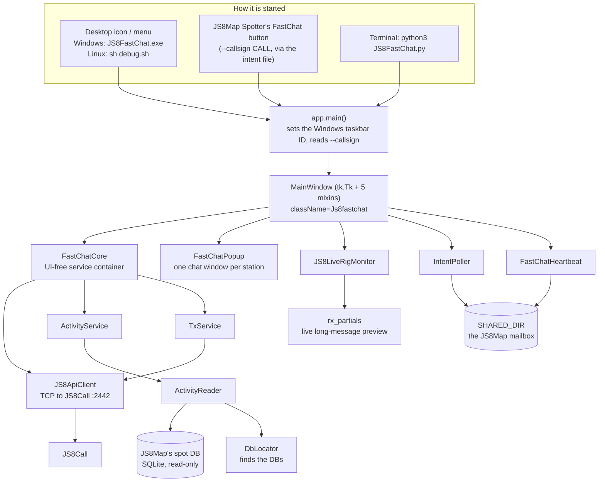
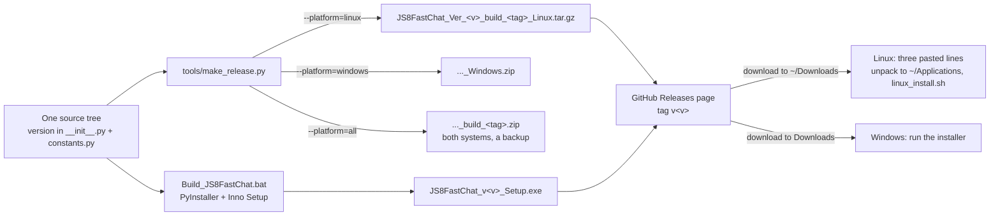

# JS8FastChat - Architecture

How the program is put together, for contributors. For *using* it see the
JS8FastChat Instructional Guide; for installing it see `README.md` in this
folder; for open items see the Issues page of
[JS8MapChat](https://github.com/mjordan501/JS8MapChat).

FastChat lives in the JS8MapChat repository, beside JS8Map Spotter:

```
JS8MapChat/                 README, LICENSE (GPL-3.0), .gitignore, .gitattributes
  check_twins.bat           the Windows build's twin gate (section 6)
  docs/                     the illustrated PDF guides for both apps
  JS8Map Ver <v>/           JS8Map Spotter
  JS8FastChat Ver <v>/      this app
```

Version described: **1.76** (build 2026-10-31). Revised 2026-11-12 for the
GitHub repository.

---

## 1. What it does, and the rules it follows

JS8FastChat is a per-station chat console for JS8Call. It reads the shared spot
database that JS8Map / JS8Map Spotter fills, shows who is on the air, and gives
each station its own chat window with history, signal reports, stored messages
and an inbox. It transmits through JS8Call's TCP API.

It is one half of a pair. JS8Map Spotter draws the map; FastChat does the
talking. Neither starts the other, and each has a button to bring the other to
the front.

Design rules, in order of importance:

| Rule | Why | How |
|---|---|---|
| **Never transmit by accident** | This is a radio. A stray frame goes out over the air with the operator's callsign on it | Every send goes through one place (`TxService`); **TX Armed** and **Confirm TX** are separate gates; the transmit lock is process-global (`tx_lock.py`) |
| **A station is its full callsign** | W3BFO and W3BFO/P are two rigs that can be on the air at once, in different places | `norm_call()` everywhere for identity; `base_call()` only for your OWN call and the FCC lookup (section 5) |
| **User data never in the program folder** | The app is installed, rebuilt, moved and shared; settings must survive all of it | Four folders with four jobs, none of them the source tree (section 4) |
| **The two apps must agree on where the mailbox is** | If they disagree the handoff fails silently -- each app thinks the other is not running | One file, `shared_resolver.py`, byte-identical in both apps, checked on every release (section 6) |
| **One source tree for Windows and Linux** | Two copies drift | All code in `js8fastchat/`; one `tools/make_release.py` builds every package (section 8) |
| **Linux: nothing to compile** | The build machine was a bottleneck; a Linux release needed a second PC and a container | Linux ships the `.py` files and runs them with the system's Python + Tk |
| **Never take the app down for a side feature** | A failed tooltip or a missing database must not close a chat window | `with self.soft(...)` around optional work; every service method is best-effort |

---

## 2. Big picture



Everything runs in one process with one Tk root. The only threads are the API
client's socket work, the live rig monitor and the intent poller; all three hand
results back to the UI thread.

---

## 3. Source layout

| Path | Role |
|---|---|
| `JS8FastChat.py` | Entry point. Also what PyInstaller builds from. |
| `js8fastchat/__init__.py` | `APP_VERSION` - the version the release script reads first. |
| `js8fastchat/app.py` | `main()`: Windows taskbar identity, `--callsign`, builds `MainWindow`. |
| `js8fastchat/core.py` | `FastChatCore` - the services with no Tk, so the same logic backs the console, the standalone popup and the map-launch host. |
| `js8fastchat/constants.py` | Version, the four folders, every file name, the tooltip and macro defaults. Read section 4 before changing anything here. |
| `js8fastchat/models.py` | `UserAppConfig`, `ActivityRow`. |
| `js8fastchat/app_config.py` | Loads and saves `UserAppConfig`, including older config files and renamed settings. |
| `js8fastchat/utils.py` | `norm_call`, `base_call`, time and frequency formatting, watch-word matching. |
| `js8fastchat/call_info.py` | Who a station is: FCC / Canadian lookup, grid, distance, the HEAR / HEARD panel numbers. |
| `js8fastchat/shared_resolver.py` | **Twin file.** Must stay byte-identical to JS8Map's copy. Finds the mailbox. |
| `js8fastchat/fastchat_heartbeat.py` | Writes `js8fastchat_alive.json` so JS8Map can enable its FastChat button. |
| `js8fastchat/data/activity_reader.py` | Reads JS8Map's SQLite databases and turns them into `ActivityRow`s. The largest single file. |
| `js8fastchat/data/db_locator.py` | Finds JS8Map's spot, relay, FCC and Canadian databases. |
| `js8fastchat/data/js8call_ini.py` | Reads `JS8Call.ini` for the operator's callsign, groups and watch list. |
| `js8fastchat/data/zip3_latlon.py` | First-three-digits-of-ZIP to approximate lat/lon, the last fallback for distance: when there is no grid and the FCC record has a ZIP but no lat/lon. A copy of JS8Map's table. |
| `js8fastchat/services/js8_api.py` | The TCP client: probe, config, speed, send, store, halt. |
| `js8fastchat/services/activity_service.py`, `tx_service.py` | The two services `FastChatCore` holds: activity rows, and the one path every transmission takes. |
| `js8fastchat/services/live_rig_monitor.py` | Listens to JS8Call's event stream. |
| `js8fastchat/services/rx_partial.py` | Assembles long incoming messages frame by frame for a live preview. |
| `js8fastchat/services/intent_poller.py` | Watches the mailbox for JS8Map's "open FastChat on this call" requests. |
| `js8fastchat/ui/main_window.py` | The console: station lists, selection, tiles, Add Call. ~3,300 lines. |
| `js8fastchat/ui/main_window_*.py` | Four mixins split out of it: the builder / send path, message popups, group activity, the UI substrate and the rig-intent-speed bar. |
| `js8fastchat/ui/fastchat_popup.py` | The per-station chat window. |
| `js8fastchat/ui/tx_lock.py`, `tx_indicator.py` | The process-global transmit lock and its sine-wave display. |
| `js8fastchat/ui/theme.py`, `design_tokens.py` | Dark and light themes. The structural colours are JS8Map's, so the two apps look like one. |
| `debug.sh`, `Run_JS8FastChat_Debug.bat` | Run from source, Linux and Windows. |
| `Launch_JS8FastChat.vbs`, `Launch_FastChat_Popup.vbs` | Windows: start from source with no console window; the second opens straight to one callsign's chat window. |
| `linux_install.sh`, `update_linux.sh`, `tools/install_linux_launcher.sh` | Linux install, update, and the menu / desktop icons. |
| `tools/make_release.py` | **The only way a release package is made** (section 8). |
| `Build_JS8FastChat.bat`, `JS8FastChat.spec`, `JS8FastChat.iss` | The Windows installer build. |
| `README.md`, `ARCHITECTURE.md` | Install instructions for users; this document. |

`.gitignore`, `.gitattributes`, `LICENSE` and `check_twins.bat` are at the
repository root and cover both apps.

`MainWindow` is `class MainWindow(_GroupActivityMixin, _MessagePopupsMixin,
_UISubstrateMixin, _RigIntentSpeedMixin, _BuilderSendTxMixin, tk.Tk)`. The
mixins are one class split across files for editing, not a layered design --
they share `self` freely. Read that line before wondering where a method lives.

---

## 4. Data: four folders, four jobs

Confusing these caused a real bug (ticket #26): a frozen FastChat wrote its
settings into PyInstaller's temp folder and lost them on every close, silently,
because the launcher ran it hidden.

| Name | What it is | Rule |
|---|---|---|
| `_SOURCE_DIR` | Where this source tree literally sits. `_MEIPASS` when frozen. | Read-only assets. **Never write here.** |
| `ROOT_DIR` | The app's real folder on disk: the `.exe`'s folder when frozen, the app root when a script. | A place to **look**, not a place to write. May be read-only (Program Files). |
| `DATA_DIR` | FastChat's own state: config, layout, debug log, sent-message log, capture log. | The **only** place this app writes its own state. |
| `SHARED_DIR` | The JS8Map ↔ FastChat mailbox. | Both apps must compute the same path. |

`DATA_DIR` and `SHARED_DIR` are per-user and **independent of where the app is
installed**:

```
Windows   %LOCALAPPDATA%\JS8MapChat\FastChat   and  ...\JS8MapChat\Shared
Linux     ~/.local/share/JS8MapChat/FastChat   and  ~/.local/share/JS8MapChat/Shared
macOS     ~/Library/Application Support/JS8MapChat/...
```

That independence is what made the 1.76 move to a source install painless: the
program moved from `~/.local/lib/JS8FastChat` (1.75.1 and earlier), through
`~/JS8FastChat` (the first 1.76 tests), to `~/Applications/JS8FastChat Ver 1.76`,
and every setting, and the JS8Map handoff, kept working untouched.
`~/Applications` is now the standard home for every JS8MapChat app on Linux.

Files in `DATA_DIR`, all written by FastChat:

| File | Contents |
|---|---|
| `mjs_js8fastchat_3_2_config.json` | Host, port, theme, scale, filters, macros, watch words |
| `js8fastchat_layout_3_2.json` | Window sizes and positions, inbox read watermarks |
| `js8fastchat_tx_history_3_3.json` | What **we** sent, per station - the gold side of a chat window |
| `js8fastchat_capture_3_4.json` | What each station sent to anyone, kept past JS8Map's DB window |
| `js8fastchat_3_2_debug.log` | Diagnostics |

Files in `SHARED_DIR` - the mailbox. FastChat writes the first, reads the rest:

| File | Direction |
|---|---|
| `js8fastchat_alive.json` | FastChat → JS8Map: "I am running" |
| `js8fastchat_intent.json` | JS8Map → FastChat: "open a chat with this call" |
| `js8map_raise_fastchat.json` | JS8Map → FastChat: "come to the front" |
| `js8map_server.json` | JS8Map → FastChat: its local server port |
| `js8map_outgoing_tx.json` | JS8Map → FastChat: frames JS8Map sent, so a chat window shows both halves of a QSO |

**None of these ever belong in a release package or in the repository.**
`make_release.py` refuses to finish if one gets in, and the root `.gitignore` keeps
them out of commits.

---

## 5. Station identity - the rule that cost a release

A callsign can carry a suffix: `W3BFO/P` is the same licence as `W3BFO` but a
**different rig, in a different place, on the air at the same time**. JS8Call and
JS8Map have always shown them separately. FastChat did not, until 1.75.1.

**The rule:** a station's identity is its **full** callsign.

```
norm_call("w3bfo/p*")  ->  "W3BFO/P"     identity. Use this.
base_call("W3BFO/P")   ->  "W3BFO"       the licence. Two uses only.
```

`base_call` is correct in exactly two places and nowhere else:

* **your own call** - KW3KW/M is still you;
* **FCC / Canadian lookup and FCC distance** - one licence, one address.

Everything else keys on the full call: the station list, selection, highlight,
chat windows, message history, the sent log, the capture log, inbox counts,
stored messages, the watched flag, group membership and the long-message
preview. Before 1.75.1 the reader merged the two rigs before the list ever saw
them, and whichever was heard last won.

`ActivityRow.base` still exists and still returns `base_call(self.call)`. It was
left alone deliberately: redefining it would have made every `r.base ==
base_call(x)` comparison silently keep matching. **Do not compare identity with
`.base` in new code.**

---

## 6. Talking to JS8Map

Two separate channels, and they fail in different ways.

**The mailbox** (`SHARED_DIR`) is small JSON files, polled. It carries presence,
the "open this callsign" handoff and the bring-to-front request. Finding it is
the job of `shared_resolver.py`, which takes three anchors - the app's stable
folder, the source tree, and `DATA_DIR` - and tries them in order, ending at the
per-user path that always exists.

**`shared_resolver.py` must be byte-identical in both apps.** It is the contract:
if the two copies drift, each app computes a different mailbox, neither sees the
other's files, and both quietly conclude the other is not running. There is no
error message for this. `tools/make_release.py` compares the two copies on every
release and stops if they differ. In the repository layout it finds
`JS8Map Ver <v>/` beside this folder by itself; `tools/twin_path.txt` (personal,
never committed) can point it somewhere else. `check_twins.bat` at the repository
root does the same comparison for the Windows build, and names both version
folders: **when either app's folder is renamed for a new version, update its
path in `check_twins.bat` in the same commit.**

**Raising the other window is NOT the mailbox.** FastChat's button that brings
the map to the front uses `wmctrl`, falling back to `xdotool`, and never touches
`SHARED_DIR`. JS8Map's button that brings FastChat forward *does* go through the
mailbox (`js8map_raise_fastchat.json`). The two directions therefore fail
independently: one button can work perfectly while the other is dead. Test both.

**The databases.** FastChat reads JS8Map's SQLite spot database directly, and
read-only. JS8Map's first-run wizard is what downloads the FCC and Canadian
callsign data, which is why JS8Map has to be installed first. `db_locator.py`
hunts for all four.

---

## 7. Talking to JS8Call

`JS8ApiClient` speaks JS8Call's TCP API on port 2442. **Each connected program
takes one connection**, so JS8Call's *TCP Max Connections* must be at least the
number of programs talking to it: JS8Map, FastChat, and any companion such as
JS8Spotter or CommStat. The default is 1.

A refused connection is **silent**. The program that lost still shows activity,
because that comes from the shared database rather than from JS8Call - so it
looks healthy while the frequency and offset boxes stay empty and commands do
nothing. Both installers now say to set it to 5.

Transmitting goes through `TxService` and `tx_lock.py`. The lock is
process-global so the console and every chat window agree on whether a
transmission is in flight; `tx_indicator.py` is only its display.

---

## 8. Build and release



**Windows** gets a frozen one-file `.exe` and an installer. **Linux gets the
source**: the `.tar.gz` holds the `.py` files, `linux_install.sh` checks for
Python 3.8+ with Tk and writes the launchers, and the program runs with the
system's Python. Nothing is compiled, so the Linux package is built on the
Windows PC and the container build box is no longer in the loop.

**Distribution.** Both packages are attached to a release on the
[JS8MapChat Releases page](https://github.com/mjordan501/JS8MapChat/releases),
and the PDF guides go in the repository's `docs/` folder. Operators download
with their browser straight into their own Downloads folder; nothing is copied
between PCs. The install lines in `README.md`, the Linux guide,
`linux_install.sh` and `make_release.py` all start from the newest matching file
in `~/Downloads`. Packages are never committed (the root `.gitignore` excludes
`*.exe`, `*.zip` and `*.tar.gz`).

`tools/make_release.py` is the only way a package is made, because hand-made
zips shipped operator data more than once. It:

1. checks the version agrees in `__init__.py`, `constants.py`, `APP_BUILD` and
   the `.iss`, and that `shared_resolver.py` still matches JS8Map's copy;
2. runs the unit tests if a `tests/` folder exists;
3. packs the tree, leaving out operator data, build output, caches, personal
   files and the other system's scripts;
4. **re-opens the package** and deletes it rather than shipping it if any
   operator data got in anyway, or if a file that must be there is missing.

**Version strings to change**, all read or checked by the release script:
`js8fastchat/__init__.py` (docstring + `APP_VERSION`), `js8fastchat/constants.py`
(`APP_VERSION` + `APP_BUILD`), `JS8FastChat.iss` (six lines, plus the header
comment), `Build_JS8FastChat.bat` (the installer filename, three places, plus
the header comment) and `Run_JS8FastChat_Debug.bat`. Change `APP_BUILD`'s date
tag whenever the code changes, even within a version: `update_linux.sh` compares
build tags to decide whether there is anything to update.

**Never change**, both of which read `1.75` and must stay that way. Each
carries a comment saying so:

* the AppUserModelID in `app.py` - Windows keys pinned taskbar icons to it;
* the Start menu shortcut name in the `.iss` - an upgrade would leave an orphan.

The heartbeat is **not** on this list: `fastchat_heartbeat.py` writes
`APP_VERSION`, so it follows the version by itself. The `"1.75"` that used to
appear in its docstring was only an example.

**Line endings are part of the build.** The `.sh` files must be LF.
The root `.gitattributes` enforces that in the repository. The Linux `.tar.gz` keeps the execute bit, but the
both-systems `.zip` does not, because Python's `zipfile` cannot carry it from
Windows. That is why every script is still documented as `sh script.sh`, and why
`linux_install.sh` and `update_linux.sh` restore the execute bits.

## 9. Testing

There is no `tests/` folder yet; `make_release.py` skips the step when it is
absent and says so. Worth adding, and the obvious first cases are the ones that
have actually broken:

| Area | What to cover |
|---|---|
| Identity | `norm_call` / `base_call` on `W3BFO`, `W3BFO/P`, `w3bfo/p*`, `KW3KW/M`; that a list built from mixed rows keeps them apart |
| Paths | `DATA_DIR` is the same whether run as a script, frozen, or from another drive |
| The twin | `shared_resolver.py` resolves the same mailbox from all three anchors |
| Release | operator data is excluded; a planted config file makes `make_release.py` stop |
| Fallbacks | with no callsign found, the sent log and chat windows never show a hard-coded call |

Until then the real test is the one that has caught the most: **install the
built package and run it**, rather than running from source and assuming. A
build proven from source and broken when installed has happened twice.

---

## 10. Extending

* **A new per-station fact** (a column, a number in the chat header): add it to
  `ActivityRow`, fill it in `ActivityReader.display_rows()`, and read it with a
  `getattr` default - manual "Add Call" rows never pass through the reader.
* **Anything that identifies a station:** use `norm_call`. Section 5.
* **A new file shared with JS8Map:** add it to `constants.py`, add it to
  `make_release.py`'s exclude list **and** the root `.gitignore` in the same commit, and change
  `shared_resolver.py` in **both** apps or neither.
* **A new setting:** `UserAppConfig` in `models.py` with a default, since older
  config files will not have it. Keep existing key names.
* **Python version:** the Linux installer checks for 3.8+. The code's measured
  floor is 3.7 (vermin, with the `from __future__ import annotations` imports
  honoured). Keep those imports: without them the builtin generic annotations
  push the floor to 3.9.
